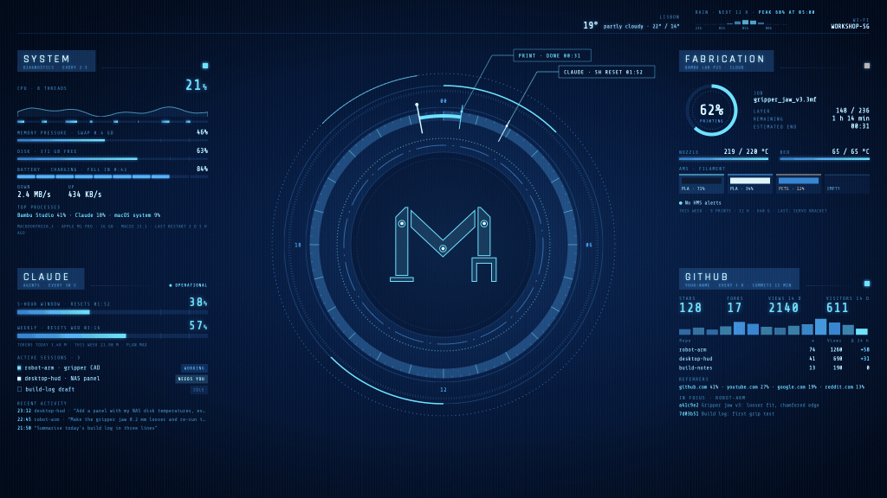

# Desktop HUD

A sci-fi heads-up display as your macOS wallpaper: system load, Claude Code usage and sessions, a 3D printer, GitHub
traffic and the weather, live on the desktop behind your windows. It's part of setting up the workbench for my
[robotics capstones](https://github.com/Morante-robotics/robotics-capstones), and I built it with Claude Code.



*Recorded from [made-up data](preview/demo_state.py), not from a real machine. The rings turn faster than on the
real desktop so the loop stays short. [Full-resolution still](docs/hud.png).*

The point of this repository isn't to give you my panels. It's to show the pattern, which is small enough that an AI
assistant can add whatever you want to monitor in one conversation.

## How it works

[Übersicht](https://tracesof.net/uebersicht/) is a free macOS app that draws web widgets (React/JSX) on the desktop,
underneath every window. Each widget declares a shell `command`, a `refreshFrequency` and a `render` function:
Übersicht runs the command on that schedule and passes its output to `render`.

Gathering everything a dashboard needs from inside widget commands gets slow and expensive quickly, so this HUD
splits the work in two:

```
 launchd ──► daemon/hud_daemon.py ──► ~/Library/Application Support/DesktopHUD/state.json
             (Python stdlib only;          │
              each source on its           │  read every 2 s with `cat`
              own schedule)                ▼
                                    widget/hud.jsx (Übersicht) ── draws, nothing else
```

- **The daemon** collects the data. Each source runs on its own schedule (CPU every 2 s, GitHub traffic every 3 h)
  and writes its result under one key of a single JSON file. When a source fails, the error is stored under
  `errors` and the other sources keep running.
- **The widget** only reads that file and draws it. Animated rings are separate HTML layers, so WebKit rotates them
  on the GPU. Animating elements *inside* an SVG made WebKit repaint the whole dial on the CPU, which cost about one
  full core.
- **`widget/actions.jsx`** is a second, clickable widget. It only appears when a login needs renewing.
- **`locate/`** is a tiny CoreLocation app that finds the city for the weather. If you deny location access, the
  daemon falls back to IP geolocation.

## Panels

| Panel | Source | Refresh |
|---|---|---|
| System: CPU per thread, memory pressure, disk, battery, network, top apps | kernel calls via `ctypes` (no `ps`, which cost 20× more) | 2 s (apps 10 s) |
| Weather, rain over the next 12 h | [Open-Meteo](https://open-meteo.com/) (no key) | 30 min |
| Official weather warnings (Spain only, optional) | AEMET public RSS | 30 min |
| Claude: 5-hour and weekly limits, tokens, open sessions, recent prompts, service status | `~/.claude` files, status.claude.com, see [the warning below](#unofficial-interfaces) | 30 s to 10 min |
| Fabrication: Bambu Lab printer progress, temperatures, AMS spools, alerts, weekly totals | Bambu Lab cloud (MQTT + REST), optional | live |
| GitHub: stars, forks, views, visitors, referrers, latest commits | `gh api` | 15 min / 3 h |
| Centre dial | 24-hour clock with upcoming events: print end, Claude limit resets | 2 s |

Colours: orange at 75 %, red at 90 % (disk 80/90 %, battery and spools 20/10 %).

## Install

Requirements: macOS 12+, [Übersicht](https://tracesof.net/uebersicht/), Python 3, the Xcode command line tools
(`xcode-select --install`, used to build the location helper), and optionally the
[GitHub CLI](https://cli.github.com/) signed in (`gh auth login`) and [Claude Code](https://claude.com/claude-code).

```bash
git clone https://github.com/Morante-robotics/desktop-hud.git
cd desktop-hud
./install.sh
```

The installer copies the daemon to `~/Library/Application Support/DesktopHUD/` and registers it with launchd (it
starts at login, restarts if it crashes and runs at low priority). It also copies the widgets into Übersicht and
turns on two Übersicht settings the HUD needs: "draw in background" for the HUD and the interaction layer for the
buttons. Re-run it after any change; `./install.sh --uninstall` removes everything except your data folder.

Then:

- Make Übersicht start at login: System Settings → General → Login Items → add Übersicht.
- Allow location access when macOS asks (for the weather city), or the HUD uses an approximate city from your IP.
- Optional printer link: `python3 daemon/bambu_login.py`.

## Configure

`~/Library/Application Support/DesktopHUD/config.json` (created from [config.example.json](config.example.json)):

| Key | Default | Meaning |
|---|---|---|
| `github` | `{"owner": null, "focusRepo": null}` | `owner`: user or organisation to show; `null` = the account `gh` is signed in to. `focusRepo`: `null` = the most recently pushed. `false` hides the panel. |
| `bambu` | `true` | `false` hides the printer panel. |
| `weatherWarnings` | `null` | `"aemet"` adds official Spanish weather warnings. |
| `recentPrompts` | `true` | `false` stops showing your latest Claude Code prompts (worth it before screen sharing). |

The service picks up changes within a minute. Debugging: `state.json` has an `errors` field per source, and the
service log is `daemon.log` in the same folder.

## Unofficial interfaces

Two panels rely on interfaces that are not public APIs, so they can stop working at any time:

- **Claude limits** read the Claude Code sign-in from your macOS keychain (`Claude Code-credentials`) and call the
  same usage endpoint the CLI uses. The token never leaves your machine except in that request to
  `api.anthropic.com`. The daemon never refreshes the token itself, because rotating it behind the CLI's back could
  sign the CLI out. When the token expires (about 8 h), it asks the `claude` CLI to renew it, at most once an hour.
  If that fails, it keeps the last values on screen with their time.
- **Bambu Lab** uses the cloud login the slicer uses. `bambu_login.py` sends your password only to
  `api.bambulab.com` and never stores it. It saves the resulting token (about 90 days, since Bambu rejects refreshes
  from third-party clients) in a file only you can read. The connection is read-only: the HUD subscribes to the
  printer's reports and never sends it commands.

## Ask an AI to add your own panel

This is the part worth copying. The daemon/JSON/widget split gives an AI assistant a small, clear contract, so a
new panel is one conversation. Open this folder in Claude Code (or any coding assistant) and describe what you
want. Give it:

1. **What to show and where it comes from.** A command, an API, a file, a device on your network.
2. **How often it changes.** The assistant will put it on the right schedule, not on the 2-second loop.
3. **When it's bad.** That's what turns it orange or red.
4. **Where on screen.** Free spots: below the system panel, or along the bottom edge.

Example prompts:

> Add a panel under SYSTEM with my Synology NAS: disk temperatures and free space, from its SNMP service at
> 192.168.1.20, every 5 minutes. Orange above 45 °C, red above 55 °C.

> Show the next three events from my work calendar on the centre dial, like the print end time. Use the macOS
> calendar, nothing online.

> Replace the GitHub panel with my Home Assistant sensors: CO₂ in the workshop and the 3D-printer enclosure
> temperature. The token is in the macOS keychain under "home-assistant".

> Add a tiny badge in the top strip when a USB serial device (Arduino, ESP32) is plugged in, with its port name.

Rules to give the assistant (or that it can read in this README):

- Data gathering goes in `daemon/hud_daemon.py`: a function scheduled with `every(seconds, fn, "key", sched)`
  that writes `state["your_key"]` under `lock`. Standard library only. Nothing slow on the 2-second loop.
- `widget/hud.jsx` only draws `s.your_key`. Animate only `transform` and `opacity`, in HTML layers, never inside
  an SVG.
- Secrets live in the keychain or in a `0600` file under `~/Library/Application Support/DesktopHUD/`, never in the
  source.
- Check it with `python3 preview/build.py && python3 -m http.server -d preview 8765`, then install with
  `./install.sh`.
- Measure the cost before and after, with the desktop visible: `./measure.sh`.

To make it yours, swap the logo in the centre: it's the `LOGO` SVG path in `widget/hud.jsx`.

## Files

| File | What it does |
|---|---|
| `daemon/hud_daemon.py` | Data service: writes `state.json` every 2 s |
| `daemon/bambu_login.py` | Links your Bambu Lab account; you run it yourself |
| `widget/hud.jsx` | The HUD (Übersicht widget, background layer) |
| `widget/actions.jsx` | Renewal buttons (Übersicht, interactive layer) |
| `locate/` | CoreLocation helper for the weather city |
| `install.sh` | Installs, updates, uninstalls |
| `measure.sh` | Measures the real CPU cost |
| `preview/` | Browser preview, demo data, and the script that records the screenshot, the GIF and the social preview |

## License

Code under the [MIT License](LICENSE); the images in `docs/` under
[CC BY-SA 4.0](https://creativecommons.org/licenses/by-sa/4.0/).
